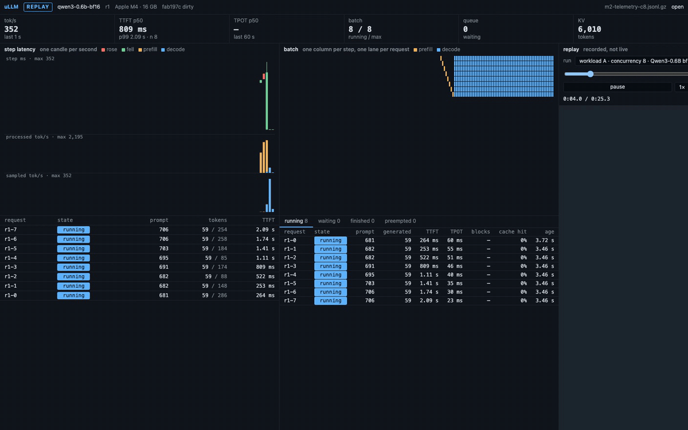
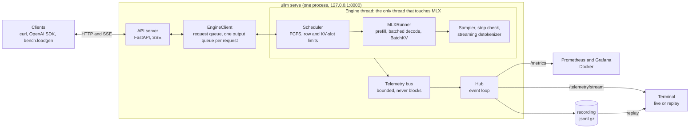

# uLLM



**[Open the hosted replay](https://kabir-fx.github.io/uLLM/)**: a recorded run of the real engine, in your browser, no install ([claims 27, 36](docs/CLAIMS.md)).

uLLM is a small, readable LLM inference engine for Apple Silicon, written from scratch on [MLX](https://github.com/ml-explore/mlx), with continuous batching, an OpenAI-compatible streaming API and a real-time terminal that shows every scheduling decision. It is a proof-of-work project, not a product: [mlx-lm](https://github.com/ml-explore/mlx-lm) is its correctness reference and its benchmark baseline, and every claim below has a row in the [claims ledger](docs/CLAIMS.md) with a command that reproduces it.

## What works today

- **Engine** (Python, MLX): its own generation loop, sampler, streaming detokenizer and stop check; continuous batching over a contiguous batch KV cache with first-come-first-served admission by row and KV-slot limits. Greedy output at batch size 1 gives exactly mlx-lm's token IDs for every golden prompt; at batch sizes 2, 4 and 8 every token is in mlx-lm's top 2 and within 0.25 logprob of its best ([claims 9, 12, 23](docs/CLAIMS.md)).
- **API server**: OpenAI-compatible `/v1/chat/completions`, streamed or not, tested with the official OpenAI Python SDK, 50 concurrent clients and client disconnects ([claims 14 to 16](docs/CLAIMS.md)).
- **Telemetry**: every engine step goes onto a bounded bus that never blocks the engine thread, out to a live stream, a recorder and Prometheus `/metrics`; telemetry on costs no throughput the benchmark can see ([claims 25, 26, 38](docs/CLAIMS.md)).
- **Terminal** (TypeScript, React, Canvas 2D): step chart, batch strip, requests table, load launcher and playground in live mode; replay of recorded runs, also as the hosted build; 60 fps under a stress trace ([claims 27 to 29, 39](docs/CLAIMS.md)).
- **Benchmarks**: paired sessions against `mlx_lm.server` under checked run conditions, with bootstrap intervals and a twin of the baseline as the noise floor ([claims 17 to 20](docs/CLAIMS.md)).
- **Grafana**: `make grafana` runs pinned Prometheus and Grafana on 127.0.0.1 with one dashboard ([claim 37](docs/CLAIMS.md)).

## Architecture



The Go router, the block-based KV cache, prefix caching and preemption are not built yet; see [Limitations](#limitations).

## Benchmarks

Workload A (distinct chat dialogues, Qwen3-0.6B in bf16), closed loop, against batched `mlx_lm.server` without prompt cache. Each ratio is paired prompt by prompt within a block, so both engines saw the same prompts under the same GPU state. This table is generated from the committed sessions in [`bench/results/m2/sweep/`](bench/results/m2/sweep/) by `make readme`, and CI fails if it drifts from them ([claim 34](docs/CLAIMS.md)).

<!-- bench.readme: generated from bench/results/m2/sweep by `make readme` -->
| uLLM ÷ `mlx-lm-batched-no-cache`, Sustained | c1 | c2 | c4 | c8 |
|---|---|---|---|---|
| Output tok/s | 1.006 [0.994, 1.020] | 1.079 [1.053, 1.099] | 1.093 [1.050, 1.117] | 1.120 [1.086, 1.170] |
| TTFT | 0.841 [0.793, 0.863] | 0.548 [0.505, 0.586] | 0.465 [0.424, 0.526] | 0.424 [0.375, 0.482] |
| TPOT | 1.014 [1.008, 1.024] | 1.003 [0.995, 1.027], within noise | 1.044 [1.018, 1.080] | 1.008 [0.964, 1.038], within noise |
| E2E | 0.989 [0.981, 0.999] | 0.919 [0.900, 0.938] | 0.912 [0.887, 0.930] | 0.891 [0.844, 0.921] |
| Prompts / blocks | 204 / 17 | 240 / 20 | 228 / 19 | 216 / 9 |

Median [95% block-bootstrap interval]; below 1 is faster for TTFT, TPOT and E2E, above 1 for output tok/s. `mlx-community/Qwen3-0.6B-bf16`, workload A, closed loop. Apple M4, 16 GB, macOS 27.2.1; mlx 0.32.4, mlx-lm 0.32.2; commit `c51200e`, dirty tree. Every session VALID under the run conditions (decision 0016).
<!-- bench.readme: end -->

Why each gap exists, from uLLM's own step recordings and mlx-lm's source, is in [the sweep's README](bench/results/m2/sweep/README.md). In short:

- **TTFT is lower, more so with concurrency.** uLLM prefills a waiting prompt at its next step. `mlx_lm.server` takes a new request only after a 0.5 s budget of batch steps (read in its source, not measured). The gap at concurrency 1 has no measured cause ([claim 30](docs/CLAIMS.md)).
- **That costs some TPOT.** uLLM prefills one prompt per step, so running requests pause for other requests' prefill: 0.101, 0.218 and 0.311 of a decode span at concurrency 2, 4 and 8 ([claim 31](docs/CLAIMS.md)).
- **Concurrency 16 has no ratio.** The baseline held 11.5 GiB and the Mac swapped, so both sessions were discarded ([claim 33](docs/CLAIMS.md)).

## Verify it yourself

On any Apple Silicon Mac with [uv](https://docs.astral.sh/uv/), Go 1.25, Node 24 and pnpm:

```sh
make verify
```

It downloads Qwen3-0.6B at its pinned revision (about 1.2 GB), then runs:

| Step | Claims |
|---|---|
| The equivalence suite at full length, 128 tokens: mlx-lm against the goldens, then uLLM's runner, engine (batch sizes 1, 2, 4, 8) and HTTP server against mlx-lm on your machine | 8, 9, 12, 14, 23 |
| The property tests: scheduler, batch KV, detokenizer, stop check, telemetry round trip | 10, 24 |
| `ullm sim`: the real engine on a fake model with 50 clients, its trace checked | 13 |
| A benchmark smoke run against `ullm serve` on the model; its run directory holds `metrics.txt` and `raw.jsonl` to compare | 26 |

On a chip other than the one that made the goldens, bf16 arithmetic can flip a near-tied greedy token; the golden check reports that as a warning, and a flip at a confident position fails. uLLM is always compared against mlx-lm run on the same machine.

Other checks: `make check` (lint, types, unit and property tests; no model), `make ci` (every CI job), `make bench-sweep` (the table above, on an idle 16 GB Mac on AC power).

## Quickstart

```sh
make models                      # Qwen3-0.6B, pinned
uv run ullm serve                # 127.0.0.1:8000; --fake runs without a model
```

```sh
curl -N http://127.0.0.1:8000/v1/chat/completions -H 'content-type: application/json' \
  -d '{"model": "mlx-community/Qwen3-0.6B-bf16", "stream": true,
       "messages": [{"role": "user", "content": "Explain the KV cache in one sentence."}]}'
```

Watch it live in the terminal:

```sh
uv run python -m bench.control --target http://127.0.0.1:8000   # optional: the load launcher
pnpm -C terminal install && pnpm -C terminal dev
# open http://127.0.0.1:5173/?live=http://127.0.0.1:8000/telemetry/stream
```

## A guided tour of the code

Start with the engine thread and follow one request.

| File | What to read it for |
|---|---|
| [`src/ullm/core/engine.py`](src/ullm/core/engine.py) | The engine loop: take new requests, schedule, run one step on the runner, emit outputs and telemetry. One thread owns all of it, and `core` never imports MLX (claim 1) |
| [`src/ullm/core/scheduler.py`](src/ullm/core/scheduler.py) | Continuous batching: who prefills and who decodes this step, FCFS, admission by rows and padded KV slots |
| [`src/ullm/core/request.py`](src/ullm/core/request.py) | The request state machine |
| [`src/ullm/core/client.py`](src/ullm/core/client.py) | The thread bridge between asyncio and the engine thread: queues only |
| [`src/ullm/runner/mlx_runner.py`](src/ullm/runner/mlx_runner.py) | Prefill and batched decode on the model, without mlx-lm's generation loop (claim 2) |
| [`src/ullm/runner/kv/batch.py`](src/ullm/runner/kv/batch.py) | `BatchKV`: the contiguous batch KV cache, one left-padded row per sequence, repacked whenever the set of rows changes |
| [`src/ullm/runner/sampler.py`](src/ullm/runner/sampler.py), [`src/ullm/core/stop.py`](src/ullm/core/stop.py), [`src/ullm/runner/detokenizer.py`](src/ullm/runner/detokenizer.py) | Sampling with per-request seeds, stop strings, streaming text |
| [`src/ullm/server/app.py`](src/ullm/server/app.py) | The OpenAI-compatible server, SSE, disconnects, `/metrics`, `/telemetry/stream` |
| [`src/ullm/telemetry/bus.py`](src/ullm/telemetry/bus.py) | The bounded bus and hub: how telemetry leaves the engine thread without blocking it |
| [`tests/equivalence/`](tests/equivalence/) | The correctness anchor: uLLM's tokens against mlx-lm's |
| [`bench/session.py`](bench/session.py), [`bench/paired.py`](bench/paired.py) | How a benchmark session is run and how its ratios and intervals are computed |

`core` plus `runner` is 1,698 lines at M2, tests excluded (`find src/ullm/core src/ullm/runner -name '*.py' | xargs wc -l`, [claim 35](docs/CLAIMS.md)). Design choices are recorded in [`docs/decisions/`](docs/decisions/).

## Limitations

- **One model, one machine.** Qwen3-0.6B in bf16, measured on a fanless 16 GB M4 Air. No other model or chip is benchmarked.
- **Batched output is close, not identical.** Above batch size 1 the forward runs at other shapes, and bf16 arithmetic can flip a near-tied token. The test holds each token to mlx-lm's top 2 within 0.25 logprob, not to exact IDs (decision 0021).
- **Contiguous KV only.** Admission reserves every row's prompt plus `max_tokens` at the longest row's size (decision 0020). Blocks, prefix caching and preemption come in M3.
- **One prompt per prefill step.** Running requests pause for each new prompt's prefill, which costs them TPOT (claim 31). Chunked or batched prefill is not built.
- **No router yet.** The Go router in `router/` is a stub; prefix-aware routing, retries and a circuit breaker come in M5.
- **No quality evals yet.** M4 adds them.
- **Concurrency 16 is not measured** on this machine, because the baseline does not fit beside macOS (claim 33).

## Repository

| Path | What |
|---|---|
| `src/ullm/` | The engine: `core/` (MLX-free decisions), `runner/` (tensors), `server/`, `telemetry/` |
| `tests/` | `unit/`, `property/`, `equivalence/`, `integration/` |
| `bench/` | Load generator, sessions, analysis; committed results in `bench/results/` |
| `terminal/` | The real-time terminal, its fixture traces and browser tests |
| `deploy/` | Prometheus and Grafana for `make grafana` |
| `router/` | The Go router (stub) |
| `docs/` | The [specification](docs/AGENT_ROADMAP.md), [decisions](docs/decisions/), the [claims ledger](docs/CLAIMS.md), the [AI log](docs/AI_LOG.md) |

`make` lists every target.

## License

[MIT](LICENSE)
